

  <picture>
    <source media="(prefers-color-scheme: dark)" srcset="header-dark.svg">
    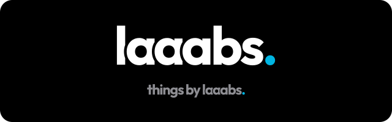
  </picture>

  a studio in madrid making native software, macOS first. 
  the tools are open source and free, with no account and no telemetry.

  <a href="https://laaabs.com"><picture><source media="(prefers-color-scheme: dark)" srcset="buttons/web-dark.svg">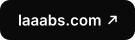</picture></a>&nbsp;
  <a href="https://handbook.laaabs.com"><picture><source media="(prefers-color-scheme: dark)" srcset="buttons/handbook-dark.svg">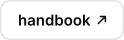</picture></a>&nbsp;
  <a href="https://github.com/bylaaabs/brand"><picture><source media="(prefers-color-scheme: dark)" srcset="buttons/brand-dark.svg"></picture></a>&nbsp;
  <a href="https://github.com/bylaaabs/homebrew-tap"><picture><source media="(prefers-color-scheme: dark)" srcset="buttons/tap-dark.svg">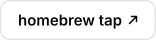</picture></a>

---

<picture>
  <source media="(prefers-color-scheme: dark)" srcset="map-dark.svg">
  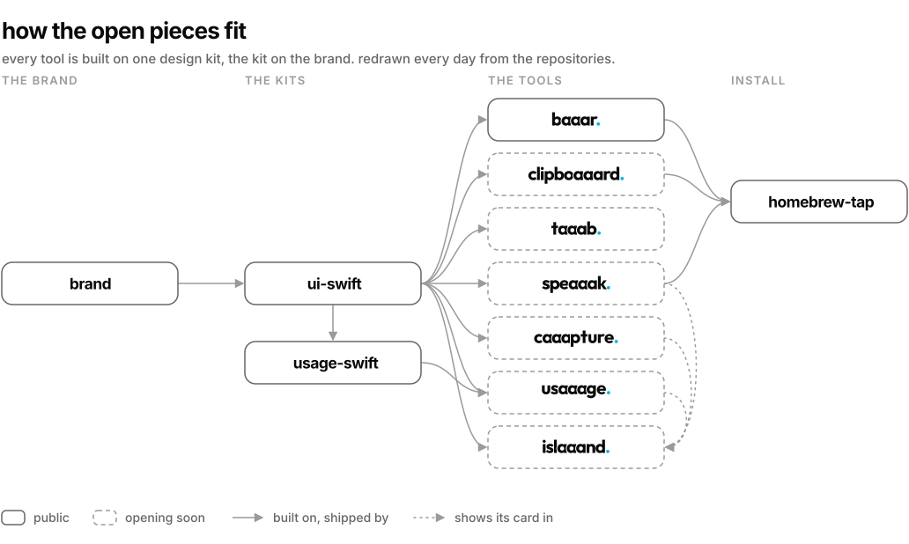
</picture>

<!-- repos:start -->
#### tools

<a href="https://github.com/bylaaabs/baaar"><picture><source media="(prefers-color-scheme: dark)" srcset="cards/baaar-dark.svg">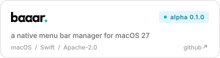</picture></a>
<a href="https://laaabs.com/tools/clipboaaard"><picture><source media="(prefers-color-scheme: dark)" srcset="cards/clipboaaard-dark.svg">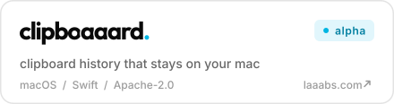</picture></a>
<a href="https://laaabs.com/tools/taaab"><picture><source media="(prefers-color-scheme: dark)" srcset="cards/taaab-dark.svg">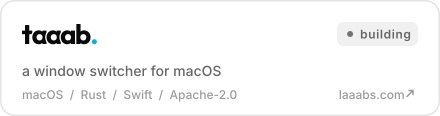</picture></a>
<a href="https://laaabs.com/tools/speaaak"><picture><source media="(prefers-color-scheme: dark)" srcset="cards/speaaak-dark.svg">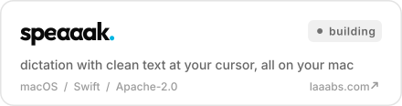</picture></a>
<a href="https://laaabs.com/tools/caaapture"><picture><source media="(prefers-color-scheme: dark)" srcset="cards/caaapture-dark.svg">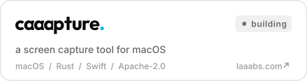</picture></a>
<a href="https://laaabs.com/tools/usaaage"><picture><source media="(prefers-color-scheme: dark)" srcset="cards/usaaage-dark.svg">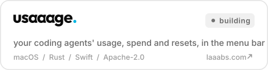</picture></a>
<a href="https://laaabs.com/tools/islaaand"><picture><source media="(prefers-color-scheme: dark)" srcset="cards/islaaand-dark.svg">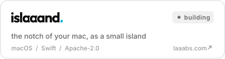</picture></a>
<a href="https://laaabs.com/tools/haaarness"><picture><source media="(prefers-color-scheme: dark)" srcset="cards/haaarness-dark.svg">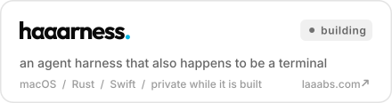</picture></a>

#### apps

<a href="https://laaabs.com/apps/finaaance"><picture><source media="(prefers-color-scheme: dark)" srcset="cards/finaaance-dark.svg">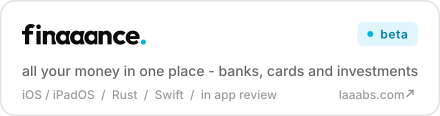</picture></a>

#### alongside

<a href="https://github.com/bylaaabs/homebrew-tap"><picture><source media="(prefers-color-scheme: dark)" srcset="cards/homebrew-tap-dark.svg">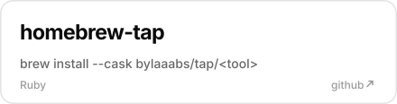</picture></a>
<a href="https://github.com/bylaaabs/brand"><picture><source media="(prefers-color-scheme: dark)" srcset="cards/brand-dark.svg">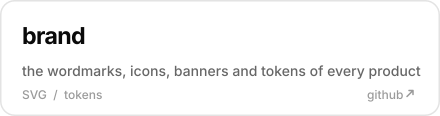</picture></a>
<a href="https://github.com/bylaaabs/ui-swift"><picture><source media="(prefers-color-scheme: dark)" srcset="cards/ui-swift-dark.svg">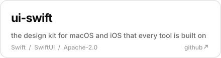</picture></a>
<a href="https://github.com/bylaaabs/usage-swift"><picture><source media="(prefers-color-scheme: dark)" srcset="cards/usage-swift-dark.svg">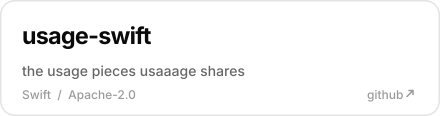</picture></a>

#### project

<a href="https://github.com/bylaaabs/.github"><picture><source media="(prefers-color-scheme: dark)" srcset="cards/github-dark.svg">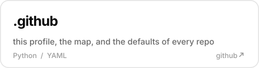</picture></a>

<!-- repos:end -->

### help build

the tools are built in the open. pull requests are welcome on every public repo: open an issue first, so we can say yes before you spend the time.

  <a href="https://github.com/bylaaabs/.github/blob/main/CONTRIBUTING.md"><picture><source media="(prefers-color-scheme: dark)" srcset="buttons/contributing-dark.svg"></picture></a>&nbsp;
  <a href="https://github.com/search?q=org%3Abylaaabs+is%3Aissue+is%3Aopen+label%3A%22good+first+issue%22%2C%22good+first+task%22&type=issues"><picture><source media="(prefers-color-scheme: dark)" srcset="buttons/first-issue-dark.svg">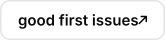</picture></a>&nbsp;
  <a href="https://github.com/bylaaabs/.github/blob/main/SECURITY.md"><picture><source media="(prefers-color-scheme: dark)" srcset="buttons/security-dark.svg">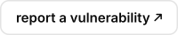</picture></a>

